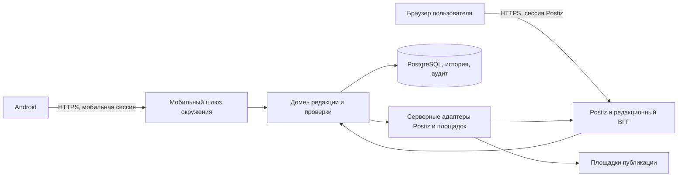

# Интеграция и приёмка Android-панели

Редакция 1.1 от 9 ноября 2026 года, Europe/Moscow.

Начать с [ТЗ](TECHNICAL_SPEC.md), затем использовать
[исполнительский промпт](prompts/IMPLEMENT_ANDROID_PANEL.md). Этот документ
связывает требования, существующий код, будущий API и доказательства приёмки.

## База реализации

Документы подготовлены в checkout `c68a463` версии `0.11.9`. Для разработки
использовать проверенный `main` на `a4f3524` (`0.14.5`) или его совместимого
преемника. SHA удалённого `main` сверено на дату ТЗ. Ветка
`codex/android-max-monitor` входит в историю `main`. Её телефонный сценарий
работает через закрытый MAX-чат и веб-Postiz. Перед проектированием адаптеров
зафиксировать фактические версии Python, Postiz и образов, тип БД, роли,
доступные маршруты и проверки на целевом стенде. Совпадение исходного кода
с версией рабочего сервера требует отдельной проверки.
[Зафиксированный main](https://github.com/vovkmic-wq/max-postiz-editorial/tree/a4f3524ef71a940dec6b93e21b40bfa6303f9b2d).

| Требования | Источник и поведение в `a4f3524` | Что реализовать |
| --- | --- | --- |
| R01, N02, N03, N05 | `deployment/postiz-max/editorial.controller.ts` проверяет активную Postiz cookie-сессию владельца, организацию и Origin. `server_api.py` принимает внутренние серверные заголовки | Отдельный HTTPS API с мобильной сессией. Сохранить проверку веб-сессии и изоляцию внутренних маршрутов |
| R02 | `server_api.public_state` возвращает сводку, недавние записи и резерв. `monitor_api.py` содержит read-only проекции монитора | Собрать безопасную модель чтения со свежестью каждого компонента и допустимым по политике резервом |
| R03, R07 | `routes_api.py`, `platform_management.route_state` и `route_details.py` дают списки и историю редакционных объектов. `postiz.py` читает календарь | Связать состояния через сохранённые ID, добавить курсоры, проекцию попыток и историю мобильных операций |
| R04 | `server_state.py` проверяет revision и меняет общую паузу. `routes_api.py` использует `HubCore.pause_target`. Нативные guards защищают рабочие пути | Переиспользовать доменные переходы, добавить CAS на изменение адресата и атомарную проверку готовности к возобновлению. Отдельно показывать сохранённые внешние QUEUE |
| R05 | Есть пауза проекта и адресата, bridge mutation lease и защита отправки. Общего ручного барьера записи в проверенной базе нет | Ввести барьер в серверном состоянии, подключить его к существующим guards Postiz и worker, покрыть конкуренцию |
| R06 | `platform_management.reconcile` читает внешние результаты для поддерживаемых прямых маршрутов и пишет локальный Audit. MAX использует отдельную bridge/browser-цепочку | Выделить безопасные просмотр и запуск сверки. Для MAX добавить адаптер точного readback с проверкой snapshot, блокировок и повторным CAS |
| R06, восстановление | `preapproval_retirement.py` и `docs/PREAPPROVAL_DRAFT_RECOVERY.md` задают вывод доказанно неотправленного MAX DRAFT до согласования. `unbound_selection_reconciliation.py` относится к отдельному сбою подготовки | В M1 подключить только проверенный переход для подходящего MAX DRAFT с отдельным правом владельца. Остальные случаи показывать по наблюдениям сервера |
| R08, R09 | `route-action` и `route-admin` обслуживают редакционные действия, медиа и настройки в браузере. Согласование точного снимка уже проверяется сервером | Переиспользовать проверки и реализацию разрешённых действий. Веб-операции подключать только по allowlist; сессию браузера вести отдельно |
| R10 | Документация upstream описывает API публикаций, интеграций, медиа, аналитики и уведомлений | Проверить наличие и область доступа API у установленной версии. Сопоставить каждую функцию с конкретным проверенным маршрутом. [Postiz Public API](https://docs.postiz.com/public-api/introduction) |

Перед подключением функции проверить её фактические побочные эффекты.
`HourlyArticleCycle.status()` и `MaxBridge.sync()` могут менять локальное
состояние. Для GET использовать отдельную проекцию. Исторические Hub API
отмены и unlock, чат-команды и внутренний API не публиковать через шлюз
целыми группами. Чат-команда диагностики блокировки не заменяет ручной барьер.

## Поток данных

Шлюз использует общие доменные сервисы с Postiz и единое состояние
окружения. У Android отсутствует доступ к Postiz Public API key, внутренним
заголовкам, БД, browser-bridge, моделям, SSH и профилям браузера. В браузере
пользователь проходит штатный вход Postiz. Для перехода разрешены только
HTTPS-ссылки сервера из утверждённого списка. Реальные адреса и credentials
задаются в приватной конфигурации. На первом этапе согласовать VPN, DNS,
сертификаты, OIDC issuer и схему привязки аккаунта к организации. Известная
LAN HTTP-конфигурация проекта не является готовым мобильным входом.

## Контракт мобильного API

Ниже предлагаемый контракт `/mobile/v1`. Реализация фиксируется
машинным OpenAPI до начала подключения клиента. Каждое окружение имеет
однозначный идентификатор и HTTPS origin. Сервер выводит организацию и
оператора из авторизованной сессии. ID из запроса всегда проверяются по области
доступа.

| Метод и путь относительно `/mobile/v1` | Назначение | Поля и ограничения |
| --- | --- | --- |
| GET `/capabilities` | Вход и переговоры о версии | `environment_id`, `server_version`, `api_version`, `server_time`, `project_timezone`, список действий и причин недоступности по маршрутам |
| GET `/overview`, `/targets`, `/reserve` | Снимок состояния | Время наблюдения, revision, режим процессов, сроки, счётчики, причины недоступности |
| GET `/calendar`, `/queue` | Период и очередь | UTC `from`/`to`, фильтры, ограниченный размер страницы, непрозрачный курсор с привязкой к области и фильтрам |
| GET `/queue/{item_id}`, `/dispatches/{dispatch_id}`, `/audit` | Карточки и история | Состояния редакции, Postiz, попытки и evidence раздельно. Разрешённые версии, hashes, метки времени, причины и ссылки |
| POST `/operation-plans` | Предпросмотр действия | Возвращает `plan_id`, `plan_hash`, ожидаемые версии, эффект и срок действия. Может хранить краткий план. Очередь, доставки и внешние системы сохраняют состояние |
| POST `/operations` | Подтверждение и приём команды | `operation_id` (UUID клиента), `action`, объект, ожидаемая версия, `plan_id`, `plan_hash`, явное подтверждение, причина. `202` для принятой новой операции |
| GET `/operations/{operation_id}` | Статус и квитанция | `running`, `succeeded`, `blocked` или `unknown`. Дополнительная пара `plan_id` и `plan_hash` позволяет подтвердить истечение точного неиспользованного плана ответом `410 MOBILE_OPERATION_NOT_ACCEPTED` |
| M2. Черновики, медиа и календарь | Редакционный цикл | Зафиксировать CRUD для черновиков и загрузку медиа отдельно. Согласование, отмена и перенос проходят через тот же журнал команд |

При потере ответа Android сохраняет UUID и параметры подтверждения. После
восстановления связи клиент читает квитанцию по прежнему UUID. Если квитанции
нет и срок плана истёк, клиент запрашивает статус с точными `plan_id` и
`plan_hash`. Шлюз сверяет владельца, окружение, срок и наличие записи журнала
под той же блокировкой плана, которую использует приём команды. Ожидание можно
закрыть по ответу `410 MOBILE_OPERATION_NOT_ACCEPTED`. Один `404`, включая
случай удалённого из журнала плана, оставляет ожидание для дальнейшей сверки.

Запись очереди содержит собственный ID, связанные ID редакции, Postiz и
отправки, `target_id`, `scheduled_at`, `revision`, `snapshot_hash`,
`editorial_state`, `postiz_state`, `dispatch_state`, `delivery_evidence`,
список блокировок и разрешённых действий. Связь строится по сохранённым
идентификаторам и версии. При расхождении идентификаторов запись показывается
как несверенная. Совпадение названия и времени не подтверждает связь.

Для M1 разрешённый набор команд — `pause_project`, `resume_project`,
`pause_target`, `resume_target`, `hold_item`, `release_item_hold` и
`reconcile_dispatch` и `retire_preapproval_no_send`. Сервер публикует подмножество по окружению, роли,
маршруту и конкретной записи. Включение продолжения подготовки отдельно
зависит от серверного режима. Поддерживаемая команда использует единый
серверный барьер с Postiz и worker. Для M2 сервер добавляет команды только
после контрактной проверки и приёмки.

**Правила обработки.** Все ответы приватных маршрутов с
`Cache-Control: no-store`. Ошибка содержит машинный `code`, безопасное описание и
`correlation_id`. `401` требует входа, `403` закрывает действие,
`404` не раскрывает чужие объекты, `409` требует перечитать ревизию или
разобрать конфликт, `422` проверяет вход, `429` передаёт срок ожидания,
`503` показывает недоступность. Неизвестное состояние или версия схемы
переводит затронутый экран в режим чтения. Новые enum-значения никогда
не дают права на изменение.

**Конкуренция и обрывы.** До отправки запроса клиент сохраняет
`operation_id` в контексте окружения. Сервер связывает его с оператором,
областью и каноническим hash команды. Одинаковый ID и payload возвращают
существующую квитанцию, изменённый payload получает конфликт. Новый claim
и запись операции фиксируются до возможного эффекта. Под блокировкой сервер
сверяет актуальную версию, область, маршрут, snapshot, leases и полномочия.
После внешнего чтения повторяет CAS перед изменением состояния. При потере
ответа клиент опрашивает GET; `404` сам по себе не доказывает отсутствие
эффекта. Повторная явная подача той же команды допустима только по правилам
действующего контракта с тем же ID. Новый ID, автоповтор изменения,
синхронизация офлайн-команд и повтор Send запрещены при неизвестном исходе.

### Разбор неизвестного исхода

1. **Просмотр.** GET карточки возвращает уже сохранённые наблюдения, причину
   препятствия и разрешённые действия. Если активна отправка или lease, карточка
   объясняет ожидание. Возобновление наблюдения происходит по правилам
   существующего адаптера.
2. **Сверка доставки.** `reconcile_dispatch` принимает ID ранее начатой
   отправки и сверяет её точный снимок. Допустимые выводы — подтверждённая
   доставка, расхождение и недостаток доказательств. Сверка делает внешнее
   чтение и при достаточном доказательстве фиксирует факт в редакции.
   Send, upload, изменение расписания и запуск моделей исключены.
3. **Доказанная неотправка до согласования.** Для подходящего MAX DRAFT без
   отправки сервер может предложить `retire_preapproval_no_send` по ID
   редакционной записи. План включает безопасное описание доказательств,
   текущую ревизию и эффект `retired_no_send`. Шлюз использует штатный inspect,
   проверяет отдельное право и свежую аутентификацию владельца, принимает
   обоснование и явное подтверждение. Доменный сервис применяет план с тем
   же `operation_id` и исходным hash только после повторной проверки паузы,
   связей, доказательств и отсутствия согласований, попыток, leases и
   конфликтующих claims. Мобильная личность фиксируется в аудите
   через серверную привязку к владельцу. Внутренние заголовки и сырой план
   остаются на сервере. В результате запись выводится из обработки, слот
   получает `missed`, старый DRAFT и история сохраняются, а постоянный
   барьер запрещает его отправку.
   Кнопка «Закрытие просроченного слота» также доступна для кандидата с
   `POSTIZ_UNKNOWN` до отправки и истёкшим lease моста. План проверяет
   журнал HTTP 504, время выдачи точного lease и два чтения DRAFT. При
   подтверждении lease снимается в одной транзакции с закрытием слота.
   Для рабочей роли записи шлюза нужен `UPDATE(mutation_owner, mutation_until)`
   на `hub_bridge_posts` в дополнение к правам существующего шлюза. Право
   чтения и конфигурация окружения сами по себе эту команду не включают.
4. **Остальные известные неотправки.** Штатные ветви известной отмены без
   попыток и доказанного сбоя до клика в `article_reserve.py` работают по
   собственным условиям. Панель показывает их результаты и причины отказа.
   Отдельные мобильные команды допустимы после собственной приёмки этих
   переходов. Существующие проверки режима, точного Postiz ERROR и журналов
   сохраняются.
5. **Недостаток доказательств.** `unknown` и удержание слота сохраняются.
   Принятая или завершившаяся команда сверки сама по себе не меняет исход
   доставки. При конфликте обновить карточку. При потере ответа опрашивать
   статус по исходному ID команды. Ни один из переходов здесь не включает
   отправителя и не ставит замену на освободившийся слот.

## Приёмка

Каждый сценарий получает итог `pass`, `fail`, `blocked` или `not_run`,
уровень проверки и ссылку на обезличенное доказательство. Указывать
точные версии клиента, шлюза, сервера и Postiz, режим транспорта и окружение.

| ID | Требования | Сценарий и наблюдаемый результат |
| --- | --- | --- |
| A01 | R01, N02, N03, N05 | Стенд и рабочее окружение разделены. Чужие объект, маршрут, организация и токен не получают доступа. Отзыв сессии закрывает запись. HTTP, поддельный TLS, ошибочный issuer, подмена redirect и чужой host отклоняются |
| A02 | R02, R03, R07 | Календарь, очередь, попытки и резерв совпадают с эталонным снимком Postiz и БД. Проверить пустую страницу, пагинацию, часовые пояса, старый heartbeat, разные состояния резерва. GET не меняет БД, outbox и транспорт |
| A03 | R04, R05 | Пауза до claim и до внешнего действия останавливает новую отправку. Начатая попытка сохраняет фактический исход. Невозможность отозвать внешний QUEUE показана явно. Возобновление проекта сохраняет паузу адресатов |
| A04 | R04, R05, R06 | Снятие ручной блокировки не обходит общую паузу, disabled, активный/осиротевший lease, права, качество, `sending` или `unknown`. Противоречивый `ARTICLE_REMOTE_CHANGED` удерживает слот |
| A05 | R04, R05, R07, N04 | Два телефона, Postiz и worker одновременно действуют на один объект. При stale версии виден конфликт, эффект один. Повтор UUID с тем же hash возвращает прежний результат; с другим hash отклоняется. Проверить потерю ответа и процесса |
| A06 | R06 | Из карточки Android сверить точный результат без Send. Несовпадение текста, медиа, даты или адресата, неполный поиск, 429 и сбой Postiz сохраняют запрет повтора. Подтверждённый факт MAX сохраняется, даже если Postiz пока QUEUE. Потеря ответа проверяется по ID команды |
| A07 | R06, R07 | На стенде показать «Закрыть без отправки» только при допустимом плане. Проверить право владельца, свежий вход, обоснование, повторный CAS и квитанцию. Доказанная неотправка закрывает только нужный слот, старый DRAFT и история сохраняются. Проверить запрет при одной лишь отметке DRAFT/ERROR, активной попытке или lease, смене доказательства и обрыве |
| A08 | R08, R09 | Создать и изменить допустимый черновик, проверить медиа и точное согласование. Изменить одно подписанное поле и получить отзыв согласования. Перенос/отмена выполняются однократно, результат перечитан из Postiz |
| A09 | N01, N02, N04, N06 | API 33–37, физическое устройство с Android 17, VPN и Wi-Fi, отказ в локальном сетевом разрешении, потеря сети и обновление приложения. Проверить TalkBack, крупный текст, ориентацию и кеш только на чтение |
| A10 | R09, R10, N05 | Неподдержанная операция показывает причину или разрешённый веб-переход. Инциденты не раскрывают тексты, токены, приватные адреса. Доставка push-уведомления не меняет состояние публикации |

Регрессионная база `a4f3524` включает `tests/test_server_races.py` и
`tests/test_server_postgres.py` для управления, `tests/test_bridge_mutation_cas.py`
и `tests/test_route_authority_fence.py` для конкуренции,
`tests/test_reserve_delivery_atomic.py` для фиксации доставки и
`tests/test_preapproval_retirement_postgres.py` для доказанной неотправки.
К ним добавить проверки мобильного контракта, экрана и гонки с Postiz.

## Этапы и выпуск

1. **E0. Инвентаризация.** Зафиксировать baseline, серверы и роли, маршрут
   HTTPS/VPN, Postiz-контракт, поддержанные операции и окружение приёмки.
2. **E1. Контракт и чтение.** OpenAPI, авторизация, read-only проекции,
   поддельный транспорт, Android-сборка и проверка A01, A02, A09.
3. **E2. Оперативное управление M1.** Журнал, CAS, общий барьер, пауза и
   продолжение, точная сверка и закрытие доказанно неотправленного MAX DRAFT.
   A03–A07 на восстановленной изолированной БД
   PostgreSQL с транспортом, который не может публиковать в живые каналы.
4. **E3. Редакционный цикл M2.** Черновики, медиа, точное согласование,
   календарь и поддержанные отчёты. A08, A10 и повторная проверка регрессий.
5. **E4. Пилот.** Проверить сборку и обновление, отзыв сессии и отключение
   шлюза, восстановление истории и совместимость миграций. Сначала
   отдельное окружение только на чтение. Подключение рабочего окружения и
   запись включаются по утверждённому перечню. Любая живая публикация
   требует отдельной предусмотренной проектом авторизации и своей приёмки.

План отката начинается с выключения мобильных команд, сохранения
незавершённых операций, отзывов сессий и перехода в режим чтения.
Мобильное отключение не удаляет данные и не восстанавливает старую БД
поверх актуальной. Снижение версии сервера возможно только при
совместимости формата журнала и всех установленных защит. Документировать
проверенную процедуру восстановления до пилота.
