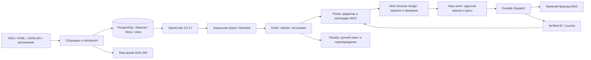

# Архитектура

SQLAlchemy/Alembic управляют PostgreSQL архива редакции. Postiz имеет отдельные
PostgreSQL/Redis/Temporal и не заменяет эту БД. Повторно использованные модули
MAX живут в самостоятельном namespace; старый путь согласования закрыт HubService.

Для MAX provider Postiz передаёт запрос review и наблюдает pending/status.
Postiz QUEUE не создаёт approval. Зеркало фиксирует ревизию, точное время,
hash настроек, текста и медиа; отправку разрешает только агент.
Mutation guard блокирует изменение во время sending/unknown. Перед внешним
запросом агент фиксирует sending и повторно читает авторитетный Postiz.

Потеря ответа остаётся unknown до сверки; exactly-once не заявляется.
Completed возвращается Postiz только при verified доставке. Общий guard для
обычных Postiz-провайдеров остаётся неподтверждённым; TG/VK отключены.
Подробнее: [адаптер MAX](MAX_BROWSER_ADAPTER.md).

