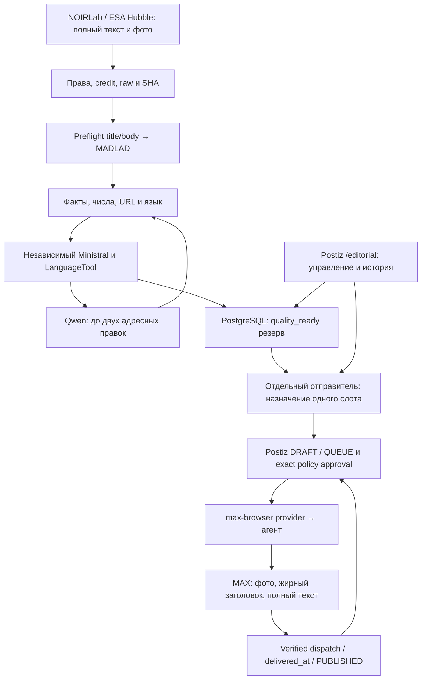

# Архитектура

Версия 0.11.5, 29 октября 2026, Europe/Moscow.

Оба прохода принадлежат одному серверному владельцу. Долгие GET и inference
выполняются вне транзакции отправителя. PostgreSQL сохраняет durable claims,
ledger, publication slots, ревизии и fencing. Миграция 0008 дополняет
прежние таблицы редакции; БД Postiz, Redis и Temporal остаются отдельными.

OpenCode 127.0.0.1:4108 используется для Qwen/Ministral через общий API
10.20.30.95:8083/v1. MADLAD — отдельный проверяемый адаптер с точным alias
и hashes worker/весов/tokenizer/config; параметры сегментации не меняют
требование перевести и проверить полный материал.

Postiz не создаёт разрешение отправки сам: агент проверяет точные текст,
медиа, дату, адресата, policy/evidence и согласование. Изменения требуют
нового approval; sending/unknown и mutation lease блокируют правки.
Подтверждённое время MAX сохраняется до последующего GET Postiz.
Неизвестный эффект удерживает слот до сверки; exactly-once не заявляется.

Hub-классы и legacy-таблицы сохраняют историю, но старый Hub UI/worker,
Windows worker и desktop heartbeat параллельно не запускаются. Другие
маршруты не включаются автоматически. [Приёмка](ACCEPTANCE.md),
[данные](DATA_MODEL.md), [адаптер MAX](MAX_BROWSER_ADAPTER.md),
[эксплуатация](VM_EDITORIAL.md).
