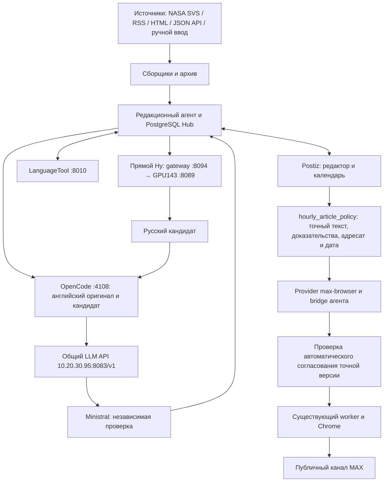

# Паспорт компонентов и подключений MAX–Postiz

**Живой результат 20 октября 2026, 23:01 МСК:** NASA SVS 5632 опубликована в
23:01:13 с одной попытки: verified dispatch, Postiz PUBLISHED, точная проза и обе
ссылки сверены в MAX. После доставки все пять адресатов paused, активных отправок
и mutation leases нет. VM source/import/distribution 0.6.20, 340 файлов сверены;
29 адресных Linux-проверок и 28/28 эксплуатационных проверок успешны. Heartbeat
ACTIVE с точным промптом 0.6.20 и прежним почасовым расписанием; отправляет один
существующий worker --dispatch-only. Пропущенные часы не догонялись.
AC-защита рабочего места реально применена и повторно прочитана; DC сохранены.
Отдельная задержка исполнения без новых событий сна осталась необъяснённой.
Для подготовки необходим работающий desktop Codex; это не автономный VM cron.

**Диагностика 20 октября 2026, 22:15 МСК:** последняя доставка NASA SVS 5595
подтверждена в 07:56:09 МСК: один verified dispatch, Postiz PUBLISHED и точный
текст MAX. На VM работают прежний dispatch-only worker и панели; все пять
адресатов paused, активных отправок и mutation leases нет. Следующая подготовка
5594 не создала DRAFT и заблокирована после истечения своего часа.
Журналы Windows подтверждают сон от крышки и гибернацию 08:19–15:40 и
17:42–22:04 МСК; отсутствие работы в промежутке бодрствования этим не объяснено.
Для восстановления регулярности добавлена обратимая AC-защита рабочего места:
[описание и откат](WORKSTATION_POWER.md). Результат её применения и развёртывания
0.6.20 фиксируется в CHANGELOG отдельно после проверки. Публикации пропущенных
часов не догоняются; работа desktop Codex остаётся необходимой.

**Живая проверка 20 октября 2026, 01:52 МСК:** полный новый цикл NASA SVS 5670
Hy → независимый Ministral → LanguageTool → Postiz → MAX завершён в 01:50:14.
После содержательных исправлений кандидата Ministral дал положительный ответ;
сбой advisory-envelope восстановлен без нового inference, с новым LanguageTool
и hard gates. Один Postiz post, одно policy-согласование и одна попытка доставки.
Hub verified, Postiz PUBLISHED, точный основной текст и обе ссылки независимо
сверены в MAX. Интервал после SSHA — 3660,42 секунды, повторов нет. Все пять
адресатов снова paused; heartbeat ACTIVE с промптом 0.6.19, один существующий
dispatch-only worker. На VM import/distribution/source 0.6.19, 336 файлов,
730 тестов и 28/28 health checks. Следующая подготовка по расписанию 02:05 МСК;
это назначенное время, а не подтверждённая будущая публикация.

**Живая проверка 20 октября 2026, 01:03 МСК:** SSHA опубликована в 00:49:14 МСК
с одной попытки. Hub verified, Postiz PUBLISHED, точный текст независимо сверен
в MAX. Интервал с предыдущей доставкой — 3614,54 секунды, дубликатов нет.
Все пять адресатов вернулись на паузу; активных dispatch и mutation leases нет.

**Исходники 0.6.19, 20 октября 2026:** advisory warnings отделяются от
содержательных issues и получают собственный bounded-контракт. Новый адресный
protocol recovery не вызывает модели и не согласует отправку: исходный
положительный typed verdict сохраняется, затем нужны hard gates и свежий
LanguageTool. Исторический schema-invalid остаётся в аудите. Результаты
развёртывания и следующего полного цикла фиксируются отдельно после проверок.

**Проверено 20 октября 2026, 00:25 МСК:** VM source/import/distribution 0.6.18,
333 файла сверены, 632 теста и 28/28 health checks прошли. Исправлен конфликт
120-минутного профиля с почасовой automatic-политикой; обычные маршруты сохранили
прежние лимиты. Для уже запланированного SSHA выполнено одно адресное согласование
без переноса даты, повторного Postiz POST или inference. Тот же пост QUEUE и одно
pending-задание ожидают 00:49 МСК; новой фактической доставки пока нет. Heartbeat
ACTIVE с промптом 0.6.18, один существующий dispatch-only worker; остальные адресаты
paused. Между подтверждёнными доставками max_test снова возвращается на паузу.
Подготовка зависит от работающего Codex на компьютере владельца; назначенную
отправку исполняет VM. Следующим heartbeat требуется сверка всех трёх подтверждений.

**Проверено 20 октября 2026, 00:01 МСК:** VM source/import/distribution 0.6.17,
331 исходный файл сверены; 590 тестов и 28/28 health checks прошли. Политика
automatic/meaning-first-v1 включена, Codex heartbeat ACTIVE с промптом 0.6.17,
периодичность почасовая на пятой минуте. Один worker dispatch-only; между
отправками все адресаты paused, активных dispatch/lease нет. Следующий SSHA DRAFT
проверен новой рубрикой и LT, сохраняет тот же ID и ожидает свободного интервала.
Человек для новых почасовых статей не требуется. Подготовка зависит от работающего
Codex на компьютере владельца, исполнение назначенной отправки — от VM.
Исправление Markdown-ссылок проверено offline; новая живая отправка 0.6.17
ещё не выполнялась. Предшествующая подтверждённая доставка описана ниже.

**Живая проверка 19 октября 2026, 23:49 МСК:** automatic-политика завершила цикл
NASA SVS 5654 через один Postiz post: verified dispatch в 23:48:59, PUBLISHED
и независимая сверка точного текста в MAX. max_test снова paused, активных
отправок и mutation leases нет; остальные маршруты не запускались.

**Проверено 19 октября 2026, 23:37 МСК:** VM source/import/distribution 0.6.16,
329 файлов совпадают с исходным bundle, 537 тестов и 28/28 health checks прошли.
Automatic-политика с meaning-first-v1 включена, один существующий worker остаётся
dispatch-only; другие маршруты не включались. Живой контроль новой рубрики
отклонил потерю отрицания одним запросом. Новая статья ещё проходит полный цикл;
это описание инфраструктурной готовности само по себе не доказывает доставку.

**Новое решение 19 октября 2026, версия исходников 0.6.16:** для почасового
max_test обязательный человек отменён. Явная automatic-политика использует
meaning-first-v1: стиль и допустимые формулировки advisory, существенные ошибки
и hard gates блокируют. Старые отказы сохраняются; отдельная адресная миграция
на новую рубрику не равна согласованию. Результаты развёртывания и живой доставки
записываются отдельно в CHANGELOG; прежние датированные снимки ниже сохранены.

**Проверенное состояние 19 октября 2026, 22:37 МСК:** source/import/distribution
0.6.15. Развёрнут путь человеческого разбора валидного отказа Ministral; полный
verdict сохраняется как rejected. Прежняя статья восстановлена из канонического
trace в один DRAFT без inference/согласования/отправки. Postiz: 12 PUBLISHED,
3 DRAFT, 0 QUEUE; все пять адресатов paused. На VM прошли 412 offline тестов,
28/28 эксплуатационных проверок; реальной новой доставки это не доказывает.
Heartbeat возобновлён с новым правилом, один Hub worker работает dispatch-only.
Модели, адреса, gateway, Postiz image и очереди этим обновлением не менялись.

**Проверенное состояние 19 октября 2026, 21:37 МСК:** source/import/distribution
0.6.14, Hy memory guard включён; политика human включена, один worker работает
с `--dispatch-only`, Postiz processors только main/max, остальные 34 исключены,
RUN_CRON пуст. Локальная почасовая автоматизация Codex включена на пятую минуту.
Все пять адресатов остаются paused до человеческого согласования; никаких
согласований агентом или новых отправок не выполнялось. Postiz сохранил
12 PUBLISHED и 1 старый DRAFT. Живые положительный/отрицательный контроли моделей
прошли, реальная статья получила отказ и экспортирована приватно для разбора;
успешный новый DRAFT и доставка этим прогоном не подтверждены.

Редакция документа: **0.6.20, 20 октября 2026, Europe/Moscow**. Контракт новой
почасовой цепочки — Hy-MT2-7B, независимый Ministral и автоматическая политика.
На проверенной VM перед этим обновлением находилась **0.6.12**, все задания
оставались на паузе. При последующем развёртывании 19 октября подтверждены
**0.6.14** в import и distribution metadata, 116 Linux-проверок нового кода и
включённый memory guard gateway. Hub ещё работал с `--no-worker`, политика была
выключена, все адресаты на паузе. Исходный compose и ручной процесс ниже не
подтверждают включение почасовой задачи или новую живую публикацию. Дальнейшие
результаты фиксируются отдельно в [CHANGELOG](../CHANGELOG.md).

Исторический снимок установки: **18 октября 2026, Europe/Moscow**. Исходный аудит версий
редакционной VM выполнен в 03:41–03:42 МСК; инфраструктура и модели — в ходе
того же аудита. После развёртывания 18 октября исходники и установленные
метаданные Python-пакета обновлены до **0.6.11**. Датированные версии и результаты
того аудита ниже сохранены; они описывают состояние на момент своих проверок.

Версии ниже разделены на прочитанные в работающей установке, указанные в
deployment-файлах и непроверенные. Пароли, токены, cookies, приватные ключи
и содержимое рабочих БД сюда не включены. IP, порты, имена компонентов и
пути приведены для понимания подключений и восстановления.

## 1. Узлы и размещение

| Узел | Адрес и доступ | Назначение | Версия / состояние на момент аудита |
|---|---|---|---|
| Физический Proxmox `pve` | `https://10.20.30.142:8006/`, SSH `10.20.30.142:22` | Гипервизор VM 109 и 112 | Proxmox VE meta **8.4.0**, manager **8.4.21**, Debian **12**, kernel **6.8.12-43-pve** |
| VM 109 | `10.20.30.95` | Общий API моделей, router и Qwen | Ubuntu **24.04.5 LTS**, kernel **6.8.0-147-generic**, 6 vCPU / 12 GiB RAM, running |
| VM 112 `max-postiz-editorial` | `10.20.30.45`, SSH `:22`; проект `/opt/max-postiz` | Агент, Postiz, БД, OpenCode, LanguageTool, браузер MAX | Ubuntu **24.04.5 LTS**, kernel **6.8.0-147-generic**, 4 vCPU / 10 GiB RAM |
| Отдельный GPU-сервер | `10.20.30.143`, SSH `:22`, API `:8086` | Backend Ministral; не является VM на этом Proxmox | Дополнительный SSH-аудит 18 октября: kernel **6.1.0-0.deb11.21-amd64**, 8 logical CPU, 11,60 GiB доступной физической RAM, Quadro K2200 4 GiB, NVIDIA **560.35.05** |
| Keenetic / LAN | `10.20.30.254`, сеть `10.20.30.0/24` | Маршрутизация и существующий удалённый доступ владельца | Точный номер прошивки этим аудитом не проверен |
| Компьютер владельца | Windows, проект `C:\script\20261011-Max postiz` | Git, исходники, диагностика и автоматизация Codex | Не является основным Linux worker |

VM 109 имеет `onboot=1`, порядок запуска `order=10,up=90`; VM 112 —
`onboot=1`, `order=20,up=30`. Последняя загрузка Proxmox 18 октября
подтвердила автоматический запуск этих гостей. VM 110 — выключенный резерв;
его не нужно включать для текстовой публикации.

Панели доступны из LAN и через существующий WireGuard владельца
(`10.77.0.2`). HTTP-адреса панелей рассчитаны на эту частную сеть;
отдельная публичная HTTPS-публикация и проброс из интернета не настроены.
Пароли панелей и ключи SSH хранятся отдельно от Git.

## 2. Цепочка обработки и публикации



Это схема контракта 0.6.16 для почасового маршрута после его развёртывания.
Meaning-first-v1 допускает стилистические предупреждения; существенный отказ
не становится машинным одобрением. Человеческие checkbox/API не используются.
Остальные сборщики и маршруты не возобновляются автоматически.

1. Сборщики читают разрешённые RSS, HTML или JSON API. Они сохраняют
   исходный текст, URL, дату, hash и историю; повторные материалы отсеиваются.
   В почасовом сценарии агент выбирает один новый текст NASA SVS,
   `fetch_nasa_article.py` получает его narrative-часть, общий фоновый
   сборщик для этого источника не запускается.
2. PostgreSQL Hub хранит материалы, черновики, варианты, согласования,
   попытки доставки и аудит. Raw-файлы, медиа и журнал почасовых слотов
   находятся отдельно в `data/`.
3. Прямой Hy-MT2-7B переводит через dedicated gateway. OpenCode вызывает
   независимый Ministral по полному английскому оригиналу и переводу;
   LanguageTool проверяет русский язык. Без включённого Hy этот маршрут
   блокируется, Qwen/Argos fallback не используется.
4. Postiz хранит редакторскую версию и дату в календаре. Сохранение или
   постановка в очередь сами по себе не согласуют текст. Собственный
   `max-browser` связывает запись Postiz с вариантом в нашем агенте. Политика
   проверяет новые машинные доказательства, назначает дату того же DRAFT в
   Postiz и согласует точную версию, адресата и дату с аудитом. Правки текста
   сбрасывают актуальность машинной проверки и требуют повторной сверки.
   После создания DRAFT текст редактируют только в Postiz. Hub показывает его
   для чтения; затем нужно получить правки Postiz и повторить Ministral и LanguageTool.
5. Агент проверяет hash, адресата, дату и согласование политики. После
   отдельного включения существующий worker использует авторизованный профиль
   Chrome и отправляет только согласованную запись в MAX с фактическим
   интервалом не менее 3600 секунд. После подтверждения адресат снова на паузе.
   Успех требует verified dispatch, Postiz `PUBLISHED` и фактического
   точного текста в канале. `pending`, `owner_attested` или доступ к каналу
   не доказывают доставку.

В этом процессе **OpenCode** исполняет независимую проверку, dedicated gateway —
перевод Hy. **Codex** на компьютере владельца выбирает статью, готовит черновик
и контролирует результат. Для почасового max_test действует **automatic**,
решение имеет actor hourly_article_policy; агент не использует cookie/API
человеческого согласования и не ставит его checkbox. Hub с worker запускают
в одном экземпляре. Подробный процесс:
[HOURLY_ARTICLE_TESTS.md](HOURLY_ARTICLE_TESTS.md).

## 3. Проверенные версии редакционной VM

Версионные команды и выборочные сведения `docker inspect` выполнены
18 октября в 03:41–03:42 МСК без изменения runtime. Версия агента и наличие
pytest ниже уточнены после последующего развёртывания 0.6.9 в тот же день;
остальные строки сохраняют время исходного аудита.
После обновления инструкции редактора до 0.6.10 повторно сверены версия
пакета и установленные метаданные. Пройдено 172 targeted tests на VM и
две отдельные калибровки нового prompt; это не новая сквозная публикация.

| Компонент | Прочитанная версия | Роль |
|---|---|---|
| Исходники и distribution metadata `max-postiz-agent` | **0.6.10 / 0.6.10** после развёртывания 18 октября | Агент, API, сборщики, согласования и worker |
| Python system / `.venv` | **3.12.3 / 3.12.3** | Выполнение Python-кода |
| Node.js / npm | **22.23.3 / 10.9.9** | Запуск и установка OpenCode, инструменты сборки |
| OpenCode CLI и npm-пакет | **2.0.17 / 2.0.17** | Локальный runtime LLM |
| Docker client / server | **29.9.0 / 29.9.0** | Контейнеры инфраструктуры |
| Docker Compose | **5.6.0** | Объединение compose-файлов |
| nginx | **1.24.0**, Ubuntu build | LAN reverse proxy и защищённый owner-browser |
| Google Chrome | **155.0.8059.79** | Авторизация и браузерная доставка MAX |
| Playwright | **1.63.0** | Управление штатным Chrome |
| OpenJDK | **21.0.12.1** | Runtime LanguageTool |
| LanguageTool server JAR | **6.6** | Проверка русского текста |
| FastAPI / Uvicorn | **0.142.2 / 0.54.0** | HTTP API и сервер Hub |
| SQLAlchemy / Alembic | **2.0.54 / 1.20.0** | PostgreSQL ORM и миграции |
| psycopg / psycopg-binary | **3.3.6 / 3.3.6** | Драйвер PostgreSQL |
| HTTPX | **0.28.1** | HTTP-клиент интеграций |
| feedparser / beautifulsoup4 | **6.0.14 / 4.15.0** | RSS и HTML |
| Pydantic / cryptography / Pillow | **2.13.5 / 49.0.0 / 12.3.0** | Валидация, шифрование backup, обработка изображений |
| pytest | **9.1.1**, установлен при развёртывании 0.6.9 | Проверки кода в рабочей `.venv` VM |

При исходном аудите distribution metadata агента показывала **0.6.0**, а
в исходниках был указан `__version__=0.6.7`. После установки 0.6.9 расхождение
устранено: обе версии проверены как **0.6.9**. `package.json` нашего npm-wrapper
с версией `0.2.0` также не является версией Python-проекта или OpenCode.
Ruff в рабочую `.venv` VM этим развёртыванием не добавлялся; он используется
в среде разработки. Проверки 0.6.9: **237 targeted tests на Windows** и
**221 targeted test на Linux**. Это проверки кода; живой результат приведён ниже.

Списки зависимостей сохранены в [requirements.lock](../requirements.lock),
[requirements-browser.lock](../requirements-browser.lock),
[requirements-images.lock](../requirements-images.lock) и отдельных dev/
deployment lock-файлах. OpenCode закреплён в
[package-lock.json](../package-lock.json). Lock-файлы относятся к пакетам;
они не фиксируют версии всех системных apt-пакетов и внешних серверов.

### Postiz и контейнеры

| Компонент / контейнер | Версия или идентификатор | Подключение |
|---|---|---|
| Postiz с MAX provider, `max-postiz-postiz-1` | Фактический локальный tag **`max-postiz-linux:0.5.0`**; историческая upstream-база **2.25.1**, seed **`max-postiz-browser:0.4.0`** | nginx `:4007` → host loopback `:14007` → container `:5000` |
| Hub PostgreSQL | Server **17.11** | VM loopback `127.0.0.1:55438` → container `:5432`, БД `editorial_hub` |
| Postiz PostgreSQL | Server **17.11** | Только Docker `postiz-postgres:5432`, БД `postiz-db-local` |
| Redis | **7.2.16** | Только Docker `postiz-redis:6379` |
| Temporal server | **1.28.1** | Docker `temporal:7233`, также host loopback `:7233` |
| Temporal PostgreSQL | Server **16.15** | Только Docker `temporal-postgresql:5432` |
| Temporal Elasticsearch | **7.17.27**, JVM **22.0.2** | Только Docker `temporal-elasticsearch:9200` |
| Temporal UI | В compose заявлена **2.34.0**; фактически выбран закреплённый image digest | Host loopback `127.0.0.1:8088` → container `:8080` |
| Temporal admin tools | В compose заявлены server-tools **1.28.1**, tctl **1.18.4**, CLI **1.4.1**; фактически выбран закреплённый image digest | Внутренняя сеть Temporal, host port отсутствует |

При аудите все **9 контейнеров running**; **8 healthy**. У admin-tools
healthcheck не задан, поэтому ему не присваивается выдуманный статус healthy.
Версии UI/admin-tools из таблицы относятся к декларации compose; отдельная
версионная команда UI не подтвердилась, поскольку Node в UI image отсутствует.

У текущего Postiz `package.json.version` возвращает `1.0.0`; это metadata
монорепозитория, а не независимое подтверждение product release 2.25.1.
Происхождение upstream и патчей описано в
[source-manifest.json](../deployment/postiz-max/source-manifest.json).
Фактический image ID работающего custom Postiz:

```text
sha256:7940324a4e3d4f7193826b90679dfba192689b335fb9d8c53071277d01fb82e9
```

Порядок compose: [базовый](../deployment/postiz/compose.yaml) →
[images.lock](../deployment/postiz/images.lock.yaml) →
[MAX bridge](../deployment/postiz-max/compose.bridge.yaml) →
[Linux override](../deployment/linux/compose.yaml). Последний override
заменяет upstream Postiz digest локальным custom tag. Поэтому утверждение
«все итоговые образы закреплены upstream digest» неверно: инфраструктура
закреплена, а для custom Postiz нужны сохранённый image и цепочка сборки.

## 4. Модели и их подключения

Агент обращается к OpenCode `http://127.0.0.1:4108` **внутри VM 112**.
OpenCode использует provider `proxmox` и общий OpenAI-compatible API
**`http://10.20.30.95:8083/v1`**.

| Назначение | ID в OpenCode | ID общего API | Размещение backend |
|---|---|---|---|
| Основная модель общих функций, прежний переводчик | `proxmox/qwen35-9b` | `qwen35-9b` | VM 109, внутренний `http://127.0.0.1:8080`; Qwen3.5-9B-abliterated Q4_K_M |
| Почасовой переводчик 0.6.14 | Напрямую, без OpenCode | Dedicated gateway model `hy-mt2-7b-q8` | VM 112 `http://127.0.0.1:8094` → GPU143 `http://10.20.30.143:8089`, Hy-MT2-7B Q8, CPU |
| Независимый машинный рецензент | `proxmox/qwen25-coder-7b` | `qwen25-coder-7b`, также каталог содержит `ministral3-8b` | Отдельный GPU-узел `http://10.20.30.143:8086`, backend alias `ministral3-8b-abliterated-k2200` |

`qwen25-coder-7b` здесь является сохранённым совместимым именем для
**Ministral 3 8B**, а не доказательством работы Qwen Coder 7B. Не заменять
его по одному названию и не возвращать прежние LLM endpoint/model из MAX.

Qwen обслуживает llama.cpp **0.5.0-dev**, build **1**, commit **a97cce8**
(полный commit `a97cce86a8addeb9f40cba7a261c94b1f0c576cb`). В running
параметрах этого backend проверены контекст 16384, 6 threads и 16 GPU layers.
HTTP `/props` Ministral сообщает **build_info=b1-a97cce8**; полный commit и
версия OS отдельного GPU-сервера этим доступом не установлены. Kernel и
ресурсы узла дополнительно прочитаны через SSH 18 октября, см. таблицу выше.

Router в VM 109 работает на Python **3.12.3**; отдельная версия приложения
не установлена. SHA-256 прочитанного router source:

```text
8937473d340b44631801554c8abee83ecf814eac7e203dc04973a6e3a80b719d
```

`127.0.0.1:8080` выше — только фактический **внутренний backend VM 109**.
Клиентская конфигурация проекта остаётся на **10.20.30.95:8083/v1**;
переносить клиент на прежний MAX endpoint нельзя. Службы VM 109 —
`model-router.service` и `llama-server@qwen35-9b.service`. Первоначальная
GPU-проверка выполнена через существующий ограниченный доступ и HTTP metadata.
Дополнительная диагностика 18 октября использовала предоставленный владельцем
административный SSH-доступ только для чтения; второй сервер и дополнительные
inference для неё не запускались.

Проверенные 18 октября параметры прежнего article-профиля OpenCode:

| Модель | `max_tokens` | `temperature` | Дополнительно |
|---|---|---|---|
| Qwen | 2048 | 0.2 | `chat_template_kwargs.enable_thinking=false` |
| Ministral | 512 | 0 | Независимый backend проверки |

Параметры читаются из private `data/opencode-runtime/opencode.json`.
Схема их безопасного применения с backup есть в
[`configure_article_models.py`](../scripts/configure_article_models.py).
Модель не получает права самостоятельно менять адресатов или отправлять
посты. Контекстные лимиты из примера конфигурации не следует выдавать за
измерение ёмкости работающего inference backend.

Дополнительный аудит GPU143 18 октября подтвердил `llama-k2200.service`:
`MemoryMax=8G`, `CPUQuota=600%`, контекст 16384, 16 GPU layers, 6 threads,
`parallel=1`, batch/ubatch 128, Flash Attention выключен. В 12:09:29 МСК
kernel зафиксировал `CONSTRAINT_MEMCG` и завершил `llama-server` при достижении
лимита cgroup 8 GiB; наблюдавшееся использование swap было около 0,915 GiB.
Это подтверждённая нехватка памяти внутри cgroup, а не доказательство
исчерпания всей физической RAM. Лимит 10 GiB оставил бы только 1,60 GiB
остальным нагрузкам, 12 GiB превышает доступную физическую RAM. Параметры
GPU-сервера сохранены; повышение лимита требует дополнительной RAM либо
отдельно проверенного профиля с меньшим потреблением.

GPU143 загрузился в 17:20:46 МСК, загрузка модели началась в 17:20:56, а один
запрос рецензента получил HTTP 503 в 17:21:03. Временная близость подтверждена;
причина перезапуска и точная причина 503 не установлены. OOM в 12:09 не
доказывает причину перезапуска через пять часов. В проверенном интервале
нового boot OOM и thermal/power throttling не наблюдались. Конкретный следующий
review занял 131 секунду: prefill 24,86 tokens/s и decode 3,82 tokens/s.
Это измерение одного запроса, не гарантия задержки или качества рецензента.

19 октября в существующих службах `llama-translation-cpu.service` и
`llama-k2200.service` применён native параметр `--sleep-idle-seconds 15`.
Прежние unit/argv сохранены в закрытой резервной копии; подтверждён сон обеих
моделей. Лимиты памяти, контекст, CPU/GPU-профили и веса не увеличивались.
Hy и Ministral делят физические 11,60 GiB RAM GPU143.

Развёрнутая конфигурация gateway 0.6.14 включает memory guard: перед Hy пассивно
проверяет `http://10.20.30.143:8086/props` и ждёт `is_sleeping=true`, а перед
возвратом результата ждёт сна Hy через `http://10.20.30.143:8089/props`.
Это описание нового guard, а не доказательство новой сквозной публикации.
POST `/sleep` не используется. Чужие запросы общему узлу этим guard
не блокируются, а cold start увеличивает задержку.

По указанию владельца 18 октября задачи проекта были поставлены на паузу:
heartbeat `max-postiz` выключен, политика почасовых статей выключена,
все адресаты на паузе, Hub работает с `--no-worker`. Linux compose выключает
RUN_CRON и исключает все 36 очередей установленного Postiz, сохраняя
служебные workflow без обработки. Панели и хранилища остались доступны.
При проверке 19 октября перед обновлением этот профиль ещё действовал.
В исходном Linux compose 0.6.14 подготовлен отдельный ручной MAX-маршрут:
`main,max` разрешены, остальные 34 очереди исключены, `RUN_CRON` остаётся пуст.
Остальные адресаты и Reddit не включаются. Порядок проверки и ограниченного
возобновления описан в
[STARTUP_AND_HEALTH.md](STARTUP_AND_HEALTH.md).

## 5. Карта сетевых подключений

`127.0.0.1` в этой таблице означает loopback **указанного сервера**;
открытие такого адреса на компьютере владельца обращается к другому узлу.

| Откуда → куда | Адрес / протокол | Область и назначение |
|---|---|---|
| Владелец → панель агента | `http://10.20.30.45:8090/hub` | LAN/VPN, nginx → Hub `127.0.0.1:8091` |
| Владелец → Postiz | `http://10.20.30.45:4007/` | LAN/VPN, nginx → `127.0.0.1:14007` |
| Владелец → вход MAX | `http://10.20.30.45:8090/api/owner-browser/vnc.html?autoconnect=1&resize=scale&path=api/owner-browser/websockify` | Через owner-сессию Hub; далее noVNC, не прямой публичный VNC |
| Hub → Postiz Public API | `http://127.0.0.1:14007/api/public/v1` | Loopback VM 112; ключ хранится отдельно |
| Postiz container → bridge Hub | `http://host.docker.internal:8091/api/max-bridge` | Host gateway Docker; bridge key не заменяет согласование |
| Hub backend | `0.0.0.0:8091` | Фактически слушает все интерфейсы; доступ ограничивается firewall для локального proxy и Docker, это не loopback listener |
| Агент → OpenCode | `http://127.0.0.1:4108` | Loopback VM 112, авторизация приложения отдельно |
| Агент → dedicated Hy gateway | `http://127.0.0.1:8094` | Loopback VM 112, выбранный переводчик `hy-mt2-7b-q8` |
| Dedicated gateway → Hy backend | `http://10.20.30.143:8089` | LAN, native llama-server Hy CPU; это не прежний endpoint MAX |
| OpenCode → model router | `http://10.20.30.95:8083/v1` | LAN, `/models`, `/chat/completions` |
| Агент → LanguageTool | `http://127.0.0.1:8010` | Loopback VM 112, HTTP `/v2/check` |
| Hub → PostgreSQL Hub | `127.0.0.1:55438` | Только VM 112; URI с паролем находится в `.env.local` |
| Postiz → свои БД/Redis/Temporal | Docker DNS имена из раздела 3 | Отдельные compose-сети `postiz-network` / `temporal-network` |
| Владелец через SSH tunnel → Temporal UI | `http://127.0.0.1:8088` на VM 112 | Диагностика workflow; в LAN напрямую не опубликован |
| noVNC → VNC → Xvfb | `127.0.0.1:6080` → `127.0.0.1:5900` → display `:99` | Приватный экран owner-browser, Xvfb без TCP listener |
| Chrome worker → MAX | `https://web.max.ru`, канал `https://max.ru/channel_neurovideo_max` | Авторизованный пользовательский профиль, исходящий HTTPS |
| Fetch helper → NASA SVS | `https://svs.gsfc.nasa.gov` | Исходящий HTTPS, проверка прав каждого материала, без скачивания медиа в этой серии |
| Workstation → Proxmox/VM | SSH `:22`, PVE HTTPS `:8006` | Проверка закреплённых host keys, ключи/пароли отдельно от Git |

Обычный `ss` также показывает nginx `:80` и системные DNS/SSH listeners;
это не дополнительные адреса редакторской панели. Полный `docker inspect`,
`docker compose config` с подставленными env и process environment не нужны
для чтения этого паспорта и могут раскрыть секреты.

## 6. Источники, адресаты и автоматизация

| Элемент | Текущее назначение и пределы |
|---|---|
| NASA SVS / `nasa_svs_articles` | Разрешённый начальный источник почасовых тестов; полный текст выбирается отдельно, права проверяются на странице и в NASA SVS help |
| `max_test` | Тестовый адресат MAX, channel ID `-79860712657053`, публичный URL `https://max.ru/channel_neurovideo_max`; provider `max-browser`, Bot API token не используется |
| Пикабу `pikabu_neuro_images` | Привязанный профиль, ручной экспорт и attestation; не входит в почасовой автотест |
| `pikabu_main` | Без адресата, выключен |
| Telegram / VK | Выключены; данным почасовым поручением не включаются |
| Reddit API | Код клиента и заявки есть; подтверждённое одобрение доступа и разрешения на переводы/внешнее распространение отсутствуют, активного Reddit API сбора нет |
| Reddit manual / IFTTT Gmail intake | Код альтернативного приёма есть; живое подключение IFTTT не подтверждено, не подменяет разрешение источника |
| Reddit «10 постов каждые 4 часа» | Спецификация будущего профиля, выключена; не является текущим расписанием NASA |
| Vezdepost | Исторически изученный вариант; не установлен в действующей цепочке |

В раннем снимке 18 октября private hourly policy была включена для `max_test`, разрешала
только `svs.gsfc.nasa.gov`, `min_gap_seconds=3600`, `max_per_day=24`.
Между подтверждёнными публикациями адресат возвращался на паузу. Позднее
18 октября владелец поставил все задания на паузу. Это исторический результат,
а не описание актуального разрешения на автоматическое согласование.

После одной из подтверждённых публикаций 18 октября Codex heartbeat `max-postiz`
был возвращён в ACTIVE на компьютере владельца, номинально раз в час на
**5-й минуте**; фактический запуск может задерживаться. Доставка
дополнительно ограничена журналом слотов и интервалом после последней
фактической публикации. Пропущенные часы не догоняются. Desktop heartbeat
не является daemon внутри VM: без работающей среды Codex выбор и проверка
следующей статьи этой автоматизацией не выполняются.

Первым решением 19 октября владелец разрешил возобновить только **подготовку** не более одной
новой статьи за час с `approval_mode=human`. Подготовка создаёт Postiz DRAFT,
до 24 записей могут ожидать человека. Прежнее делегированное согласование агентом
для новых статей отменено. Только человек назначает дату в Postiz и явно
согласует точную версию в Hub; API Bearer и CLI publish не заменяют это решение.
Доставка разрешена лишь после человеческого согласования, с фактическим
интервалом не менее 3600 секунд и без догоняющих пачек. Статусы новой политики,
worker и desktop heartbeat после развёртывания проверяют отдельно; эта правка
документа не включает их. Остальные маршруты остаются на паузе.

Позднейшим решением 19 октября обязательный human gate для max_test отменён.
Новая automatic-политика согласует только успешную meaning-first-v1 проверку
точного текста/исходника и назначает дату того же поста. Не более одной новой
статьи за час и одной доставки за 3600 секунд, без догоняющих пачек. Старые human
черновики не получают автоматическое согласование задним числом: нужна отдельная
адресная миграция с сохранением исходного отказа и одной оценкой новой рубрики.

Фактические scheduler settings и prompt находятся вне репозитория, в
`$CODEX_HOME/automations/max-postiz/automation.toml`. Сохранённая инструкция
сценария — [prompts/HOURLY_ARTICLE_TESTS.md](../prompts/HOURLY_ARTICLE_TESTS.md),
процедура — [docs/HOURLY_ARTICLE_TESTS.md](HOURLY_ARTICLE_TESTS.md), полномочия
— [AGENTS.md](../AGENTS.md). Исходный
[IMPLEMENTATION_PROMPT.md](../prompts/IMPLEMENTATION_PROMPT.md) описывает
начальное задание, а не актуальный снимок каждого сервера.

## 7. Файлы настроек, данные и внешние компоненты

| Путь относительно `/opt/max-postiz`, если не указано иначе | Содержимое / способ подключения | В Git |
|---|---|---|
| `config/app.json`, `config/sources.json`, `config/publishing.json` | Реальные настройки runtime, источников и адресатов | Нет; примеры и схемы есть |
| `.env.local` | Именованные настройки подключения БД, Postiz, OpenCode, авторизации и backup | Нет; `.env.example` есть |
| `deployment/postiz/.env` | Compose credentials и public origin | Нет; пример есть |
| `data/opencode-runtime/opencode.json` | Реальный provider, модели и article-профиль | Нет; пример и configurator есть |
| `data/hourly-article-policy.local.json` | Политика, enabled и аудит; новый контракт automatic + meaning-first-v1 | Нет; выключенный пример есть |
| `config/translation.json` | Выбранный dedicated переводчик и локальный адрес gateway | Нет; пример есть |
| `data/hourly-articles/ledger.local.json` | Занятые слоты, URL/hash, подготовка и результат каждой статьи | Нет; удалять для повторной отправки нельзя |
| `data/max-browser/` | Авторизованный профиль Chrome | Нет; повторный вход владельца может потребоваться |
| `data/archive/`, `data/media/`, `data/backups/` | Исходные материалы, файлы, закрытые резервные копии | Нет |
| Docker named volumes | Hub/Postiz/Temporal PostgreSQL, Redis, Elasticsearch, Postiz uploads/config | Нет |
| `/etc/systemd/system/max-postiz-*.service`, nginx config | Запуск и proxy | Исходные шаблоны в `deployment/linux/` |
| `/usr/local/sbin/max-postiz-eno1-tso`, systemd unit на PVE | Закреплённая проверка NIC и TSO off | Исходники в `deployment/proxmox/` |
| `$CODEX_HOME/automations/max-postiz/automation.toml` на workstation | Prompt, расписание и фактический статус desktop-автоматизации | Нет; человекочитаемое описание выше |

Для текстовой цепочки не нужны ComfyUI, генерация изображений или видео.
Их адаптеры и примеры сохранены как опциональные компоненты:
`config/comfy/`, `deployment/comfy/`, `image_pipeline.py`, `video_tools.py`.
Отдельный CT 111 ComfyUI упомянут в [STARTUP_AND_HEALTH.md](STARTUP_AND_HEALTH.md);
его адрес, версия и состояние в данном аудите не проверялись. В опциональном
примере Wan bridge указан `http://10.20.30.95:8190`; это декларация примера,
а не подтверждение работающей генерации в текущей текстовой цепочке. Openverse,
локальные image/video weights и workflow также не считаются подключёнными
лишь по наличию кода. Docker Desktop на Windows относится к резервной/
разработческой установке и не нужен работающему Docker Engine VM 112.

## 8. Автозапуск, проверки и восстановление

В VM включены Docker, nginx, `max-postiz-hub`, `max-postiz-opencode`,
`max-postiz-spelling`, display/VNC/noVNC. Службы проекта используют
`Restart=always`, основные контейнеры — `restart: always`. Отдельная
`max-postiz-login.service` для интерактивного входа не включена автоматически.
После перезагрузки проверяют и сервисы, и действительность сессии MAX.

На PVE в 03:31 МСК применён `max-postiz-eno1-tso.service`: TSO физического
Intel I219-V `eno1` выключен. Unit enabled/active, запускается до pve-guests,
сверяет конкретный host/NIC и не перезапускает сеть. Подробности, границы
меры и откат — [E1000E_RECOVERY.md](E1000E_RECOVERY.md). Долговременная
устойчивость и следующая загрузка с этим новым unit ещё не доказаны.
Независимого аппаратного управления питанием этим изменением не добавлено.

Проверки без вывода секретов:

```powershell
# Workstation, из корня проекта: TCP, затем глубокая проверка через SSH.
.\.venv\Scripts\python.exe scripts/check-network.py --output data/network-check.local.json
.\scripts\check-startup.ps1 -Deep
```

```sh
# Внутри VM 112; короткие реальные запросы обеим моделям только с --deep.
cd /opt/max-postiz
.venv/bin/python deployment/linux/check-stack.py --deep
# Только проверка корректности compose; без раскрытия подставленных env.
sudo bash deployment/linux/postiz.sh config --quiet
```

В предыдущей проверке после восстановления 18 октября пройдены 27/27 deep
checks с реальными ответами моделей. Исходный аудит паспорта читал версии
и подключения, без новой публикации или inference.

Отдельный живой прогон 0.6.9 завершён 18 октября: статья
[NASA SVS 5643](https://svs.gsfc.nasa.gov/5643/) опубликована в MAX в
**06:22:32 МСК** при назначенном времени **06:22:23 МСК**. Подтверждены одна
попытка dispatch, `verified=true`, Postiz `PUBLISHED` и точный текст в канале
один раз. После сверки все адресаты, включая `max_test`, на паузе;
активных dispatch и mutation leases — ноль. Приватные доказательства сохранены
отдельно. Один успешный прогон не доказывает длительную устойчивость серии;
HTTP 200 или healthy-контейнеры сами по себе не подтверждают публикацию.

Для восстановления нужны исходники, приватные настройки и резервные копии
данных, сохранённый custom image Postiz и доступный LLM-сервер. Один clone
репозитория не переносит cookies, БД, веса моделей или desktop scheduler.
Linux Dockerfile начинается с локального seed `max-postiz-browser:0.4.0`;
полная чистая пересборка без него не подтверждена. Не все bootstrap-загрузки
закреплены неизменно: текущие Docker/Chrome apt packages, последний Node 22
LTS и LanguageTool-stable могут отличаться от снимка этого документа.

Порядок переноса и восстановления: [LINUX_DEPLOYMENT.md](LINUX_DEPLOYMENT.md),
[STARTUP_AND_HEALTH.md](STARTUP_AND_HEALTH.md),
[OPERATIONS.md](OPERATIONS.md). Старый Windows worker и Linux worker нельзя
включать одновременно. Перед изменением runtime сверяют `sending/unknown`
и mutation lease; после неопределённого исхода отправку не повторяют.

При обновлении установки следует обновить этот паспорт и новую запись
[CHANGELOG.md](../CHANGELOG.md), сохраняя прежние записи. Версионный снимок
не заменяет проверку текущего состояния перед публикацией или переносом.
