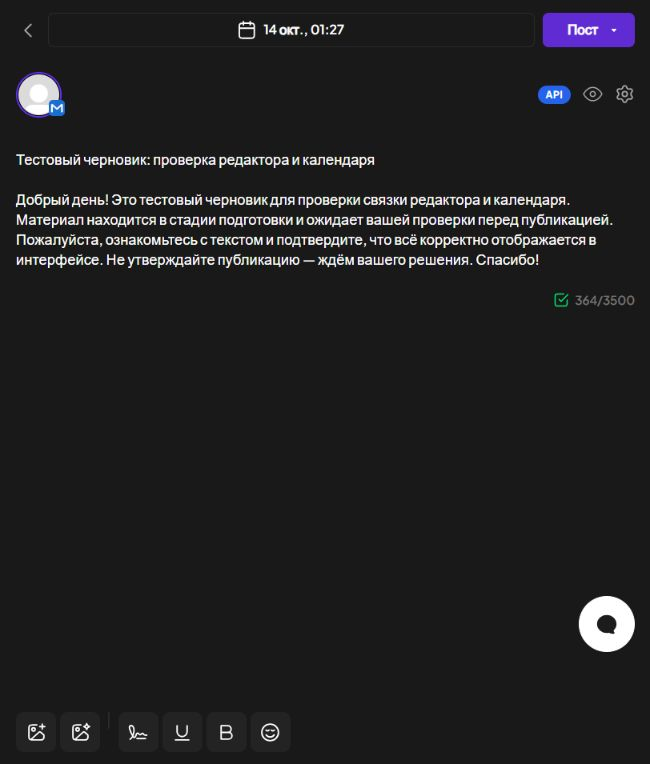

# Проверка MAX browser adapter — 13 октября 2026

**Область документа, сверено для 0.11.5 29 октября 2026:** Историческая проверка адаптера 13 октября. Текущая приёмка требует нового точного сообщения и evidence.
Актуальные эксплуатация и состояние: [VM](VM_EDITORIAL.md), [выпуск 0.11.5](RELEASE_0.11.5.md).

Дополнение 0.4.1: первый согласованный пост реально отправлен и проверен
после reload и новой сессии; Postiz — PUBLISHED. Актуальный результат:
[отчёт тестовой публикации](MAX_TEST_PUBLICATION_REPORT.md).
Ниже сохранены результаты и ограничения версии 0.4.0 до этой отправки.

Версия проекта 0.4.0, Postiz 2.25.1. Реализована выбранная цепочка:
LLM → редактор/календарь Postiz → согласование агента → прежний браузер MAX.

## Фактически проверено

| Проверка | Результат |
|---|---|
| Канал Postiz | max-browser подключён штатным API; прежний max_test/-79860712657053 |
| Локальная LLM | Настоящая Qwen3.5-9B через OpenCode подготовила тестовый draft |
| Редактор | MAX виден в Postiz; открываются календарь и черновик, лимит 3500 |
| Правка живого Postiz | Сохранённый текст импортирован агентом, ревизия 2, mutation lease снят |
| Compiled provider contract | 6 вызовов fixture-моста, без сети MAX: auth/pending/completed/unknown |
| Реальный compiled provider | Из контейнера к живому агенту: submit/status, pending/review_pending/paused |
| Temporal | Очередь MAX имеет activity poller; backlog 0 |
| PostgreSQL | Alembic head 0005; locking/migrations/backup-restore проверены |
| Регрессия | 276 passed, 0 failed, 531.27 s |
| Повторная ключевая проверка | 19 bridge + 3 PostgreSQL = 22 passed, 62.39 s |
| Код | Ruff src/scripts/tests/migrations прошёл |
| Docker | 8 running, 7 healthy; admin-tools без healthcheck |
| Исходный overlay | Source patch применён к закреплённой базе без сети, SHA-256 совпали |
| Перенос | ZIP: 197 файлов, relocation smoke прошёл с disabled targets, без runtime-секретов |
| Реальная доставка | Новых внешних постов 0; approval не выполнялся; адресаты paused |

Снимок сделан при первом открытии, до проверенной последующей правки текста.
Приватные connection/demo/runtime-отчёты находятся только в ignored data.
Текст черновика не считается готовой публикацией или подтверждением фактов.

## Защита согласования

Machine key отделён от owner/editor/viewer. Postiz QUEUE не создаёт approval.
Тесты проверяют отзыв approval после правки текста/даты/состояния/настроек,
окончательную сверку перед отправкой, изменение байтов медиа по тому же URL,
отключение/смену аккаунта/refreshNeeded, отсутствие Postiz, удаление поста,
ограничения threads/recurrence/media, токены и невозможность approval
делегированным ключом. Mutation lease не истекает в право отправки;
sending/unknown блокируют конкурирующую правку. Симуляция доставки не
превращается в completed. Реальные максимальные вложения/видеопубликация
не проверялись.

## Образ и воспроизводимость

База закреплена в source-manifest.json:
`ghcr.io/gitroomhq/postiz-app@sha256:d2b37802e96757729fdea2d3d71287f841c2b619faa1cb4c21dac07df657fde1`.
Первая полная overlay-сборка backend/orchestrator/frontend завершилась.
При запуске выявлены поздний импорт собственных классов и пропуск worker
из-за дефиса в max-browser. Исправлены порядок импортов, registry и
projection интеграций. На повторной сборке Google font dependency,
ограничение heap и перегрузка Docker/WSL не дали закончить clean build.

Работающий образ восстановлен из первой полной сборки
`sha256:3ef097b847324f3e9e0835018e0268cd9a7bc0966fc8d349f2fb12d594ba8800`
через Dockerfile.repair и точные SHA-256 модулей compiled-manifest.json.
Финальный образ `max-postiz-browser:0.4.0`:
`sha256:705fe0bfb5a8458221428949fecd13997bf23440774704f7d7ad19d54b5f9224`.
Скомпилированный frontend из успешной сборки сохранён, проверен в браузере.
Актуальный source patch содержит те же поправки и использует bundled fonts.

**Чистая сборка актуального исходного Dockerfile остаётся неподтверждённой.**
Для восстановления сохранён final image tar в ignored data; его SHA-256
записан в data/postiz-max-image-manifest.json. Source ZIP не содержит образ,
Docker volumes, ключи, cookies или пользователей. Перенос image tar не
заменяет перенос данных Postiz и новую настройку доступа браузера MAX.

После перегрузки перезапущен только Docker Desktop/его WSL distribution,
volumes сохранены; Windows не перезагружалась. Диагностически раскрытый
локальный пароль PostgreSQL отозван, заменён, панель перезапущена.

Изменения адаптера выполнены в текущем проекте. Сверка исходного MAX с
reuse-manifest импорта показала 80 совпадающих файлов из 85; пять файлов
источника уже отличаются от импортированного снимка. Они не перезаписывались
этой работой; результат не выдаётся за подтверждение неизменности всех 85.
Пути и SHA-256 расхождений сохранены только в data/max-source-drift.json.

## Оставшаяся приёмка

Нужен конкретный текст, дата и согласование владельца для реального тестового
поста. Затем проверить браузерную отправку, прочитать сообщение MAX,
зафиксировать внешний ID/ссылку и completed в Postiz. До этого подтверждены
редактор, синхронизация и контроль согласования, но не новая живая доставка.
Ограничения: один пост/одно вложение, без threads/recurrence, local uploads;
пауза, unknown и lease требуют операторской проверки.

Промпт: prompts/MAX_BROWSER_ADAPTER_PROMPT.md. Постоянная история: CHANGELOG.md.
