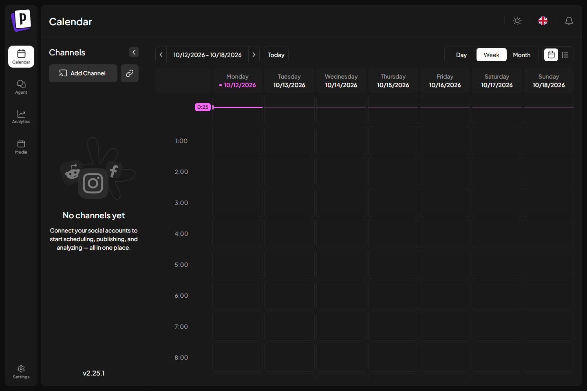

# Установка Docker и Postiz — 12 октября 2026

**Область документа, сверено для 0.11.5 29 октября 2026:** Историческая установка Docker/Postiz 12 октября. Текущий Linux runtime имеет отдельные версии Python и custom image.
Актуальные эксплуатация и состояние: [VM](VM_EDITORIAL.md), [выпуск 0.11.5](RELEASE_0.11.5.md).

Версия проекта: 0.3.1. Установка выполнена в текущем проекте;
исходные проекты MAX и Пикабу не менялись.

| Проверка | Результат |
|---|---|
| Docker Desktop | 4.94.0, установка для пользователя, exit 0 |
| Установщик | Подпись Valid; SHA-256 совпал с manifest winget |
| WSL | 2.6.1, backend WSL 2 запущен без перезагрузки Windows |
| Docker Engine / Compose | 29.8.2 / 5.5.1, daemon доступен |
| Postiz | v2.25.1, http://localhost:4007 |
| Контейнеры | 8 running: 7 healthy, admin-tools running без healthcheck |
| Образы | Все 8 закреплены по digest в images.lock.yaml |
| Temporal UI | http://localhost:8088, GET /healthz — 200 |
| Локальный владелец | Создан, повторный вход после перезапуска успешен |
| Public API редакции | GET integrations — 200 и []; GET posts — 200 и пустой список |
| Панель редакции | /api/hub/state — 200, postiz_configured=true, все targets paused |
| Данные после перезапуска | Postiz и PostgreSQL перезапущены, прежние пароль и API-ключ работают |
| Браузерная QA | Postiz Calendar, /launches — 200, вход/reload успешны, 0 JS errors |
| Контрактные проверки | 25 passed, 43.39 s; .test-state/postiz-contracts.xml |
| Статический анализ | Ruff src/scripts/tests прошёл; pip check без ошибок |
| Сборка | wheel/sdist 0.3.1 и исходный ZIP из 170 файлов |
| Перенос исходников | 170 SHA-256 проверены; doctor/tick на новом пути, явный SQLite, targets disabled, текущий .venv |
| Архив без секретов | Промпт/AGENTS/CHANGELOG включены; env/runtime исключены, актуальные секреты не найдены |
| Исходный MAX | 85 из 85 исходных файлов не изменились |
| Новые внешние публикации | 0 |

Исходная схема получена из [официальной установки Postiz](https://docs.postiz.com/self-host/installation/docker-compose)
и закреплена по commit `dd4969e5e694cd009619a0d53cff14c21104580b`.
Postiz закреплён по digest
`sha256:d2b37802e96757729fdea2d3d71287f841c2b619faa1cb4c21dac07df657fde1`.
[Документация установки Docker](https://docs.docker.com/desktop/setup/install/windows-install/)
использована для установки в режиме per-user / WSL 2.

Исправления при развёртывании: убрана двойная host IP-привязка в портах,
healthcheck Temporal обращается к своему внутреннему IP и возвращает SERVING,
Temporal UI перенесён с недоступного 8080 на 8088. Не отключались реальные
healthchecks. Сеть и volumes отделены от локального PostgreSQL редакции.

Учётные данные владельца и API-ключ — только в ignored
`data/postiz-access.json`, секреты контейнеров — в `deployment/postiz/.env`.
API редакции читает свои настройки из `.env.local`. Диагностические browser
sessions аннулированы сменой ключа; ошибки QA больше не выводят cookies.
Новая регистрация закрыта. В документации и истории секретов нет.

Социальных интеграций внутри Postiz пока нет. MAX и Пикабу используют прежние
маршруты редакции, все адресаты на паузе. Approval guard остаётся false;
публикация через Postiz и полный путь с LLM не прошли живую приёмку.
Интерфейс проверен на вход и загрузку календаря; создание Postiz draft с
конкретным социальным каналом не проверялось. Новая версия проверена затронутым
набором из 25 тестов; полный набор 254 относится к предыдущей версии 0.3.0.

Промпт: `prompts/POSTIZ_DEPLOYMENT_PROMPT.md`. Постоянное правило ведения
`CHANGELOG.md` закреплено в `AGENTS.md`; оба файла входят в исходный архив.
