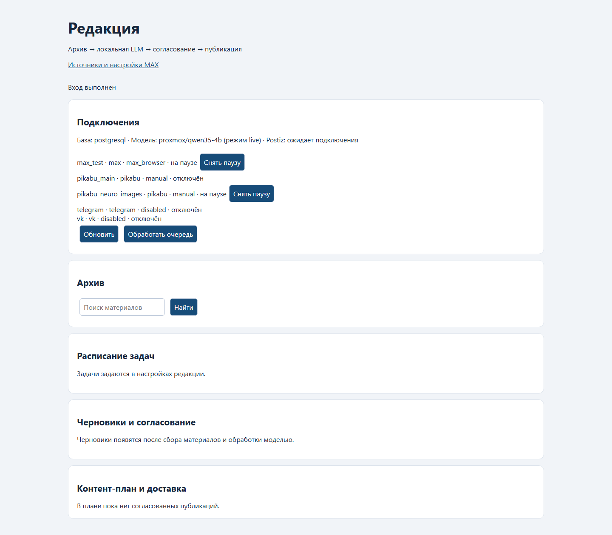
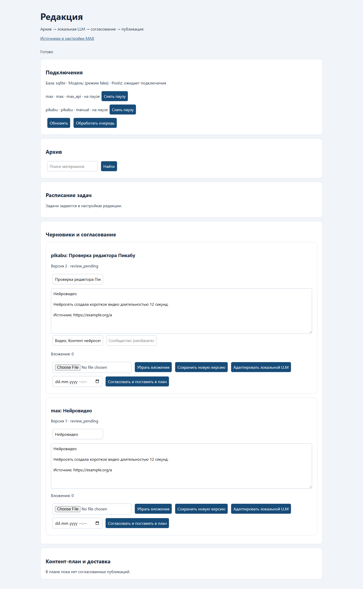

# Отчёт проверки: 11–12 октября 2026
Дополнение 0.4.1 от 13 октября: один согласованный пост реально отправлен
в MAX, Postiz — PUBLISHED; [отчёт](MAX_TEST_PUBLICATION_REPORT.md).
Обновление 13 октября, версия 0.4.0: собственный адаптер MAX установлен;
276 тестов прошли, реальный редактор и pending-мост проверены. Актуальные
результаты: [отчёт адаптера](MAX_BROWSER_ADAPTER_REPORT.md).
Реализован самостоятельный проект C:/script/20261011-Max postiz на основе MAX и контракта Пикабу. Ни один новый пост в этой работе не отправлялся.

Основной набор регрессии ниже относится к 0.3.0 от 11 октября. Docker/Postiz
установлены в 0.3.1 от 12 октября; актуальные живые проверки и ограничения:
[отчёт развёртывания](POSTIZ_DEPLOYMENT_REPORT.md).

В 0.3.2 общий API локальных моделей подключён и проверен через OpenCode:
[проверка LLM](LLM_CONNECTION_REPORT.md).

## Что работает и проверено
| Проверка | Фактический результат |
|---|---|
| PostgreSQL | Локальный 17.6, 127.0.0.1:55438, editorial_hub, Alembic 0004 |
| OpenCode | Отдельный сервер 127.0.0.1:4108, версия 2.0.17 доступна |
| LLM | В 0.3.2 proxmox/qwen35-9b через 10.20.30.95:8083/v1; ответы Qwen и Ministral через OpenCode подтверждены |
| MAX | Прежний -79860712657053, browser inspect: publish=true, live_verified=true для доступа |
| Пикабу | Прежний user8853170, ручной маршрут; API-публикация не заявляется |
| Отключённые адресаты | Telegram, VK, pikabu_main без привязки |
| Новые отправки | 0; все targets paused |
| Регрессия | 254 passed, 218.55 s, .test-state/release-suite.xml |
| Последние контракты | 51 passed, 47.79 s, .test-state/release-final-contract.xml; включают новый binding reload, блокировку старого image scheduler и повтор задачи дайджеста |
| Ruff | Все проверки src/scripts/tests прошли |
| Зависимости | pip check: No broken requirements found |
| Сборка | wheel и sdist 0.3.0 построены успешно; поставка проекта — полный source ZIP |
| PostgreSQL concurrency | Два workers: одна отправка в имитацию; отмена и правка во время sending отвергнуты |
| Файлы и согласование | Несовпадение SHA-256 блокирует отправку; история metadata Пикабу включена в approval |
| Postiz REST | Контракты draft/upload/schedule guard/unknown; в 0.3.1 реальный API подключён, GET integrations/posts проверены |
| Браузерная QA | Реальная панель PostgreSQL и отдельный SQLite editor fixture; сохранение заголовка/тегов, desktop/mobile, 0 JS errors |
| Backup | Создан data/backups/editorial-hub.enc; восстановлен в случайную схему отдельной PostgreSQL test-БД: 19 stories, 19 archived drafts, targets paused |
| История MAX | 19 stories, 19 drafts, 31 revisions, 29 revoked approvals, 17 archived intents, 17 attempts, 194 audit events; 0 Materials в источнике |
| Повтор импорта | 0 новых строк; исходная SQLite БД открывалась read-only |
| Исходные файлы MAX | 85 из 85 SHA-256 не изменились |
| ZIP / релокация | 159 файлов с manifest, doctor и tick на новом пути; явный SQLite, все targets disabled, текущий .venv |
| Проверка секретов | Текущие ключи панели, OpenCode, PostgreSQL и backup не найдены в source ZIP; runtime-файлы исключены |
| Postiz deployment | Docker Desktop 4.94.0; Postiz v2.25.1, 8 контейнеров running, 7 healthy, images закреплены по digest; отдельный отчёт 0.3.1 |

Числа последних проверок пересекаются с регрессией: складывать их как число уникальных тестов нельзя. Новые ветви после регрессии проверены отдельным финальным набором.

## Границы живой приёмки
1. Генерация локальной LLM подтверждена. Пробный Qwen draft содержит неверный source_ids; готовность текста и полный живой путь collect → LLM → publication не подтверждены.
2. Postiz instance/API key подключены, календарь и API доступны; социальные интеграции Postiz пока отсутствуют. Создание и публикация Postiz draft для реального канала не проверены.
3. Обычный Postiz UI может публиковать draft напрямую. Реальный ACL/approval guard не установлен; approval_guard_verified=false и schedule блокируется. Начальные MAX/Пикабу используют собственную панель.
4. MAX проверен на право публикации, без нового отправленного сообщения. Пикабу подтверждается владельцем вручную, verified=false.
5. Источники после переноса отключены, прежние адресаты на паузе. Старый image scheduler не запускается и не включается через Hub API.
6. Импорт истории не переносит исходные медиа/cookies/активные jobs. Существующие истории без Material доступны в поиске как standalone_story.
7. PostgreSQL на этой машине имеет локальную административную роль, loopback и отдельную тестовую БД. Многопользовательская production-схема требует отдельных ролей, TLS и проверенных внешних подключений.

## Скриншоты
Реальная запущенная панель:

Редактор с демонстрационными материалами в отдельной временной базе, fake transport:

Мобильные варианты: images/panel-mobile.png и images/editor-mobile-fixture.png.

## Перенос и артефакты
Source ZIP: dist/editorial-hub.zip. SHA-256 артефактов и проверка отсутствия текущих runtime-секретов — отдельный dist/release-manifest.json. ZIP не содержит .env.local, БД, браузерные cookies, модели и бинарники PostgreSQL/OpenCode.

Релокация выполняется scripts/relocation_smoke.py в новый каталог: проверяется каждый SHA-256 manifest, создаются новые локальные ключи, используется явный development SQLite, все адресаты disabled, doctor и tick выполняются. Зависимости для этого smoke используются из текущего .venv; это не самостоятельная повторная установка зависимостей.

Полный живой production gate остаётся открытым до доступной LLM, работающего Postiz/ограничения publishing permissions и согласованной тестовой публикации.

